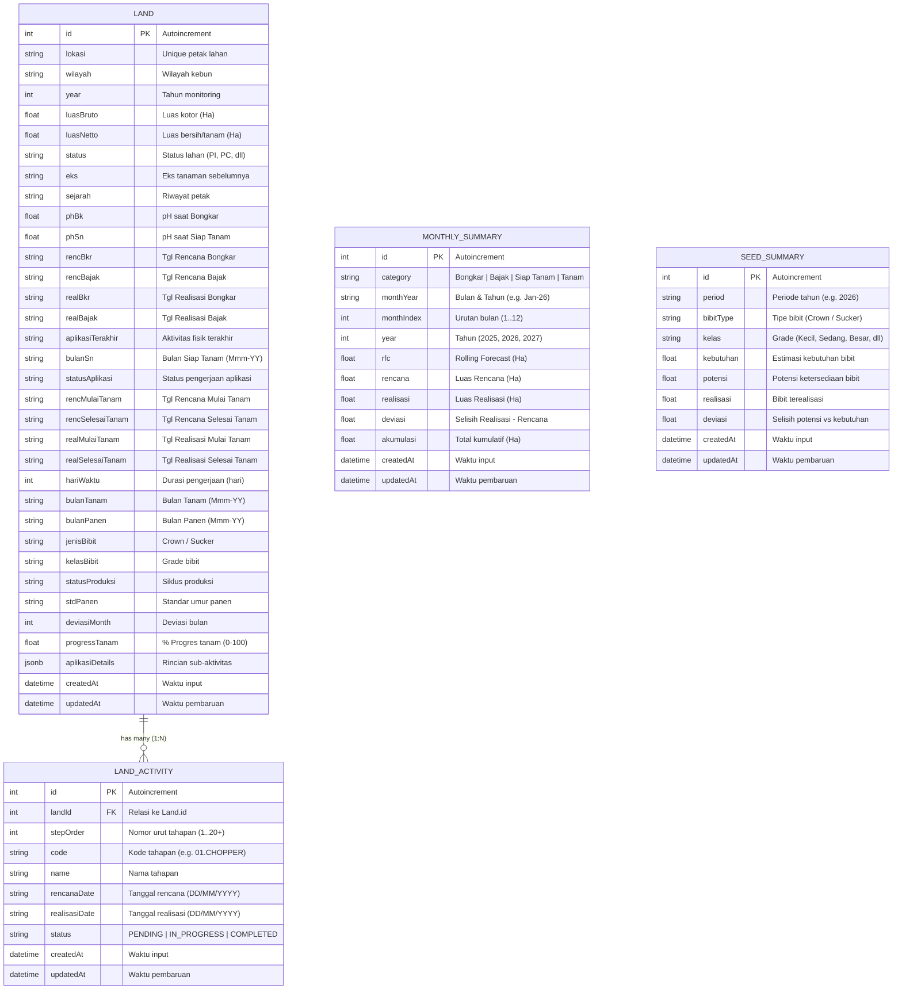

# 🗄️ Dokumentasi Struktur Database & Tabel

**Sistem:** Monitor Schedule Dashboard 2026  
**DBMS:** PostgreSQL  
**ORM:** Prisma Client (`@prisma/client`)  
**Sumber Definisi:** [`prisma/schema.prisma`](file:///d:/monitor_schedule/prisma/schema.prisma)  
**Dokumen Terkait:** [PRD Versi 2.0](file:///d:/monitor_schedule/PRD/Prd)

---

## 📌 Ringkasan Arsitektur Database

Database **Monitor Schedule Dashboard 2026** dirancang untuk memproses dan menyajikan data operasional perkebunan/monitoring lahan secara terstruktur dari file Excel (*Monitor Schedule - 2026.xlsx*). Database ini mendukung pemantauan:
1. **Master Lahan & Siklus**: Identitas petak, luasan (bruto/netto), status, varietas bibit, pH tanah, jadwal, dan progres.
2. **Tahapan Pengolahan Lahan (Activities)**: Siklus 20+ tahapan fisik mulai dari persiapan bongkar (*chopper*, dolomit, belerang, bajak) hingga penanaman.
3. **Rekapitulasi Bulanan (Monthly Summary)**: Perbandingan Rencana (*Plan*), *Rolling Forecast* (RFC), Realisasi, Deviasi, dan Akumulasi untuk tahapan Bongkar, Bajak, Siap Tanam, dan Tanam.
4. **Distribusi Bibit (Seed Summary)**: Neraca kebutuhan vs potensi ketersediaan bibit berdasarkan tipe (*Crown* & *Sucker*) dan kelas ukuran (*size grade*).

---

## 🗺️ Entity Relationship Diagram (ERD)



---

## 📋 Detail Struktur Tabel & Kolom

### 1. Tabel `Land` (Master Data Lahan)

Menyimpan seluruh data pokok petak lahan pertanian, status legal/agronomi, luasan, riwayat pH, parameter jadwal penanaman, hingga status panen.

| Nama Kolom | Tipe Data Prisma / PostgreSQL | Nullable | Default | Keterangan / Deskripsi Bisnis |
| :--- | :--- | :---: | :---: | :--- |
| `id` | `Int` / `SERIAL` | ❌ Tidak | `autoincrement()` | **Primary Key** identitas unik data lahan. |
| `lokasi` | `String` / `VARCHAR` | ❌ Tidak | - | Kode unik/nama petak lahan (contoh: `101A`, `023B`, dll). Diindeks. |
| `wilayah` | `String` / `VARCHAR` | ❌ Tidak | - | Wilayah operasional/kebun (contoh: `W01`, `W02`, `PG1`, dll). Diindeks. |
| `year` | `Int` / `INTEGER` | ⚠️ Ya | - | Tahun monitoring schedule (contoh: `2026`). Diindeks. |
| `luasBruto` | `Float` / `DOUBLE PRECISION` | ❌ Tidak | - | Luas total/kotor petak lahan dalam satuan Hektar (Ha). |
| `luasNetto` | `Float` / `DOUBLE PRECISION` | ❌ Tidak | - | Luas bersih efektif yang dapat ditanami dalam satuan Hektar (Ha). |
| `status` | `String` / `VARCHAR` | ⚠️ Ya | - | Status lahan (contoh: `PI`, `PC`, `ST`, `RC`). Diindeks. |
| `eks` | `String` / `VARCHAR` | ⚠️ Ya | - | Eks tanaman pada siklus sebelumnya (contoh: `Nenas`, `Singkong`). |
| `sejarah` | `String` / `VARCHAR` | ⚠️ Ya | - | Catatan riwayat penggunaan lahan sebelumnya. |
| `phBk` | `Float` / `DOUBLE PRECISION` | ⚠️ Ya | - | Nilai pH tanah saat tahap Bongkar (BK). |
| `phSn` | `Float` / `DOUBLE PRECISION` | ⚠️ Ya | - | Nilai pH tanah saat tahap Siap Tanam (SN). |
| `rencBkr` | `String` / `VARCHAR` | ⚠️ Ya | - | Tanggal target/rencana pembongkaran tanaman lama (`DD/MM/YYYY`). |
| `rencBajak` | `String` / `VARCHAR` | ⚠️ Ya | - | Tanggal target/rencana pembajakan tanah awal (`DD/MM/YYYY`). |
| `realBkr` | `String` / `VARCHAR` | ⚠️ Ya | - | Tanggal aktual/realisasi pembongkaran selesai (`DD/MM/YYYY`). |
| `realBajak` | `String` / `VARCHAR` | ⚠️ Ya | - | Tanggal aktual/realisasi pembajakan selesai (`DD/MM/YYYY`). |
| `aplikasiTerakhir` | `String` / `VARCHAR` | ⚠️ Ya | - | Nama tahapan aktivitas fisik lapangan terakhir yang telah diaplikasikan. |
| `bulanSn` | `String` / `VARCHAR` | ⚠️ Ya | - | Bulan target Siap Tanam dalam format `Mmm-YY` (contoh: `Jan-26`). |
| `statusAplikasi` | `String` / `VARCHAR` | ⚠️ Ya | - | Status pengerjaan lapangan (contoh: `Sls Tanam`, `Proses Tnm`, `BJK`). |
| `rencMulaiTanam` | `String` / `VARCHAR` | ⚠️ Ya | - | Tanggal target/rencana mulai tanam bibit (`DD/MM/YYYY`). |
| `rencSelesaiTanam`| `String` / `VARCHAR` | ⚠️ Ya | - | Tanggal target/rencana selesai tanam bibit (`DD/MM/YYYY`). |
| `realMulaiTanam` | `String` / `VARCHAR` | ⚠️ Ya | - | Tanggal aktual/realisasi mulai tanam bibit (`DD/MM/YYYY`). |
| `realSelesaiTanam`| `String` / `VARCHAR` | ⚠️ Ya | - | Tanggal aktual/realisasi selesai tanam bibit (`DD/MM/YYYY`). |
| `hariWaktu` | `Int` / `INTEGER` | ⚠️ Ya | - | Estimasi durasi waktu kerja penanaman dalam hitungan hari. |
| `bulanTanam` | `String` / `VARCHAR` | ⚠️ Ya | - | Bulan pelaksanaan tanam dalam format `Mmm-YY` (contoh: `Mei-26`). Diindeks. |
| `bulanPanen` | `String` / `VARCHAR` | ⚠️ Ya | - | Estimasi bulan panen dalam format `Mmm-YY` (contoh: `Jul-27`). |
| `jenisBibit` | `String` / `VARCHAR` | ⚠️ Ya | - | Jenis material bibit yang ditanam: `Crown` atau `Sucker`. Diindeks. |
| `kelasBibit` | `String` / `VARCHAR` | ⚠️ Ya | - | Klasifikasi ukuran bibit (`Extra Kecil`, `Kecil`, `Sedang`, `Besar`). Diindeks. |
| `statusProduksi` | `String` / `VARCHAR` | ⚠️ Ya | - | Klasifikasi siklus produksi (contoh: `Plant Crop`, `Ratoon 1`). |
| `stdPanen` | `String` / `VARCHAR` | ⚠️ Ya | - | Standar usia panen atau bulan panen standar. |
| `deviasiMonth` | `Int` / `INTEGER` | ⚠️ Ya | - | Selisih bulan deviasi antara realisasi vs standar panen/tanam. |
| `progressTanam` | `Float` / `DOUBLE PRECISION` | ⚠️ Ya | `0` | Persentase kemajuan tanam dari 0 hingga 100%. |
| `aplikasiDetails` | `Json` / `JSONB` | ⚠️ Ya | - | Metadata JSON berisi rincian tanggal rencana dan realisasi seluruh sub-aktivitas pengolahan tanah (lihat rincian di bawah). |
| `createdAt` | `DateTime` / `TIMESTAMPTZ` | ❌ Tidak | `now()` | Waktu sistem saat data pertama kali disimpan. |
| `updatedAt` | `DateTime` / `TIMESTAMPTZ` | ❌ Tidak | `@updatedAt` | Waktu sistem saat data terakhir kali diubah. |

#### Indeks pada Tabel `Land`:
* `@@index([lokasi])`
* `@@index([wilayah])`
* `@@index([year])`
* `@@index([status])`
* `@@index([jenisBibit])`
* `@@index([kelasBibit])`
* `@@index([bulanTanam])`

---

### 2. Tabel `LandActivity` (Rincian Tahapan Fisik Pengolahan Lahan)

Menyimpan setiap tahapan aktivitas pengolahan lahan per petak secara individual (terhubung ke tabel `Land`), digunakan untuk pelacakan alur (*pipeline*) pengolahan tanah secara sekuensial.

| Nama Kolom | Tipe Data Prisma / PostgreSQL | Nullable | Default | Keterangan / Deskripsi Bisnis |
| :--- | :--- | :---: | :---: | :--- |
| `id` | `Int` / `SERIAL` | ❌ Tidak | `autoincrement()` | **Primary Key** identitas unik aktivitas. |
| `landId` | `Int` / `INTEGER` | ❌ Tidak | - | **Foreign Key** yang merujuk ke `Land(id)`. Aturan hapus: `ON DELETE CASCADE`. |
| `stepOrder` | `Int` / `INTEGER` | ❌ Tidak | - | Urutan proses pengerjaan (Step 1 s/d 20+). |
| `code` | `String` / `VARCHAR` | ❌ Tidak | - | Kode unik aktivitas standar (contoh: `01.CHOPPER`, `11.BAJAK_AWAL`, `22.SIAP_TANAM`, `23.PROSES_TNM`). |
| `name` | `String` / `VARCHAR` | ❌ Tidak | - | Nama deskriptif aktivitas (contoh: `Chopper`, `Aplikasi Dolomit`, `Finishing Rotary`). |
| `rencanaDate` | `String` / `VARCHAR` | ⚠️ Ya | - | Tanggal target rencana pelaksanaan (`DD/MM/YYYY`). |
| `realisasiDate`| `String` / `VARCHAR` | ⚠️ Ya | - | Tanggal aktual realisasi pengerjaan selesai (`DD/MM/YYYY`). |
| `status` | `String` / `VARCHAR` | ❌ Tidak | - | Status tahapan pengerjaan: `'PENDING'`, `'IN_PROGRESS'`, atau `'COMPLETED'`. |
| `createdAt` | `DateTime` / `TIMESTAMPTZ` | ❌ Tidak | `now()` | Waktu sistem saat data aktivitas dibuat. |
| `updatedAt` | `DateTime` / `TIMESTAMPTZ` | ❌ Tidak | `@updatedAt` | Waktu sistem saat data aktivitas diubah. |

#### Indeks pada Tabel `LandActivity`:
* `@@index([landId])`
* `@@index([code])`
* `@@index([status])`

#### Daftar Tahapan Utama (`code` & `name`):
1. `01.CHOPPER` - Chopper
2. `02.CHOPPER_LU` - Chopper Lu
3. `03.RH1` - RH1
4. `04.CUTTING_BANANA` - Cutting Banana
5. `05.DOLOMIT` - Aplikasi Dolomit
6. `06.DP1` - DP1
7. `07.DP_CROSS` - DP Cross
8. `08.DP2` - DP2
9. `09.BELERANG` - Belerang
10. `10.KOMPOS` - Kompos
11. `11.BAJAK_AWAL` - Bajak Awal
12. `17.SUBSOILER` - Subsoiler
13. `18.FINISHING_HARROW` - Finishing Harrow
14. `19.FINISHING_ROTARY` - Finishing Rotary
15. `20.ROTARY_FH2` - Rotary FH2
16. `21.RIDGER` - Ridger
17. `22.JALAN_SAL` - Jalan & Saluran
18. `22.SIAP_TANAM` - Siap Tanam
19. `23.PROSES_TNM` - Proses Tanam
20. `24.SLS_TANAM` - Selesai Tanam

---

### 3. Tabel `MonthlySummary` (Ringkasan Bulanan Rencana vs Realisasi)

Menyimpan data agregasi bulanan untuk grafik dan tabel komparasi antara target, *forecast*, realisasi, dan deviasi luasan lahan.

| Nama Kolom | Tipe Data Prisma / PostgreSQL | Nullable | Default | Keterangan / Deskripsi Bisnis |
| :--- | :--- | :---: | :---: | :--- |
| `id` | `Int` / `SERIAL` | ❌ Tidak | `autoincrement()` | **Primary Key** identitas data agregasi bulanan. |
| `category` | `String` / `VARCHAR` | ❌ Tidak | - | Kategori pengerjaan: `'Bongkar'`, `'Bajak'`, `'Siap Tanam'`, atau `'Tanam'`. Diindeks. |
| `monthYear` | `String` / `VARCHAR` | ❌ Tidak | - | Label bulan dan tahun pemantauan (contoh: `Jan-26`, `Feb-26`). |
| `monthIndex`| `Int` / `INTEGER` | ❌ Tidak | - | Indeks urutan bulan dalam kalender (1 s/d 12). |
| `year` | `Int` / `INTEGER` | ❌ Tidak | - | Tahun monitoring (contoh: `2025`, `2026`, `2027`). |
| `rfc` | `Float` / `DOUBLE PRECISION` | ⚠️ Ya | - | Nilai *Rolling Forecast* luasan dalam satuan Hektar (Ha). |
| `rencana` | `Float` / `DOUBLE PRECISION` | ⚠️ Ya | - | Target luasan rencana dalam satuan Hektar (Ha). |
| `realisasi` | `Float` / `DOUBLE PRECISION` | ⚠️ Ya | - | Luasan aktual pengerjaan yang terealisasi dalam satuan Hektar (Ha). |
| `deviasi` | `Float` / `DOUBLE PRECISION` | ⚠️ Ya | - | Selisih antara luasan realisasi dikurangi rencana (`realisasi - rencana`). |
| `akumulasi` | `Float` / `DOUBLE PRECISION` | ⚠️ Ya | - | Total luasan kumulatif berjalan hingga bulan tersebut. |
| `createdAt` | `DateTime` / `TIMESTAMPTZ` | ❌ Tidak | `now()` | Waktu sistem saat data summary dibuat. |
| `updatedAt` | `DateTime` / `TIMESTAMPTZ` | ❌ Tidak | `@updatedAt` | Waktu sistem saat data summary diperbarui. |

#### Indeks pada Tabel `MonthlySummary`:
* `@@index([category])`
* `@@index([year, monthIndex])`

---

### 4. Tabel `SeedSummary` (Monitoring Kebutuhan vs Potensi Bibit)

Menyimpan data neraca kebutuhan, ketersediaan, serta deviasi bibit tanaman nenas per jenis dan klasifikasi ukuran bibit.

| Nama Kolom | Tipe Data Prisma / PostgreSQL | Nullable | Default | Keterangan / Deskripsi Bisnis |
| :--- | :--- | :---: | :---: | :--- |
| `id` | `Int` / `SERIAL` | ❌ Tidak | `autoincrement()` | **Primary Key** identitas data ringkasan bibit. |
| `period` | `String` / `VARCHAR` | ❌ Tidak | - | Periode pemantauan (contoh: `'2026'`). Diindeks. |
| `bibitType` | `String` / `VARCHAR` | ❌ Tidak | - | Tipe material bibit: `'Crown'` (mahkota) atau `'Sucker'` (anakan). Diindeks. |
| `kelas` | `String` / `VARCHAR` | ❌ Tidak | - | Klasifikasi grade ukuran bibit (`'Extra Kecil'`, `'Kecil'`, `'Sedang'`, `'Besar'`). Diindeks. |
| `kebutuhan` | `Float` / `DOUBLE PRECISION` | ⚠️ Ya | - | Total jumlah kebutuhan bibit untuk target tanam. |
| `potensi` | `Float` / `DOUBLE PRECISION` | ⚠️ Ya | - | Estimasi potensi ketersediaan bibit dari kebun asal. |
| `realisasi` | `Float` / `DOUBLE PRECISION` | ⚠️ Ya | - | Jumlah bibit yang telah terdistribusi dan ditanam. |
| `deviasi` | `Float` / `DOUBLE PRECISION` | ⚠️ Ya | - | Selisih neraca bibit (`potensi - kebutuhan`). |
| `createdAt` | `DateTime` / `TIMESTAMPTZ` | ❌ Tidak | `now()` | Waktu sistem saat data bibit dibuat. |
| `updatedAt` | `DateTime` / `TIMESTAMPTZ` | ❌ Tidak | `@updatedAt` | Waktu sistem saat data bibit diubah. |

#### Indeks pada Tabel `SeedSummary`:
* `@@index([period])`
* `@@index([bibitType])`
* `@@index([kelas])`

---

### 5. Tabel `StageStockSummary` (Neraca Stok Tahapan Fisik: Bongkar, Bajak, SN)

Menyimpan data neraca carryover stok fisik operasional bulanan (Januari s/d Desember) untuk tahun 2022 s/d 2026 yang bersumber dari sheet *Stok Lahan* Excel.

| Nama Kolom | Tipe Data Prisma / PostgreSQL | Nullable | Default | Keterangan / Deskripsi Bisnis |
| :--- | :--- | :---: | :---: | :--- |
| `id` | `Int` / `SERIAL` | ❌ Tidak | `autoincrement()` | **Primary Key** identitas data stok bulanan. |
| `year` | `Int` / `INTEGER` | ❌ Tidak | - | Tahun monitoring (contoh: `2026`). Diindeks. |
| `month` | `String` / `VARCHAR` | ❌ Tidak | - | Nama bulan (contoh: `'Jan'`, `'Feb'`, ..., `'Des'`). |
| `monthIndex` | `Int` / `INTEGER` | ❌ Tidak | - | Indeks urutan bulan kalender (1 s/d 12). |
| `monthYear` | `String` / `VARCHAR` | ❌ Tidak | - | Label bulan dan tahun (contoh: `'Jan-26'`). |
| `bongkar` | `Float` / `DOUBLE PRECISION` | ❌ Tidak | `0` | Luas lahan yang dibongkar pada bulan ini (Ha). |
| `bajak` | `Float` / `DOUBLE PRECISION` | ❌ Tidak | `0` | Luas lahan yang dibajak pada bulan ini (Ha). |
| `sn` | `Float` / `DOUBLE PRECISION` | ❌ Tidak | `0` | Luas lahan yang selesai Siap Tanam pada bulan ini (Ha). |
| `tanam` | `Float` / `DOUBLE PRECISION` | ❌ Tidak | `0` | Luas lahan yang ditanami pada bulan ini (Ha). |
| `stokBongkar` | `Float` / `DOUBLE PRECISION` | ❌ Tidak | `0` | Saldo akhir Stok Bongkar (`Stok Lalu + Bongkar - Bajak`). |
| `stokBajak` | `Float` / `DOUBLE PRECISION` | ❌ Tidak | `0` | Saldo akhir Stok Bajak (`Stok Lalu + Bajak - SN`). |
| `stokSN` | `Float` / `DOUBLE PRECISION` | ❌ Tidak | `0` | Saldo akhir Stok SN (`Stok Lalu + SN - Tanam`). |
| `totalStok` | `Float` / `DOUBLE PRECISION` | ❌ Tidak | `0` | Total stok fisik operasional (`stokBongkar + stokBajak + stokSN`). |
| `initialCarryoverBongkar` | `Float` / `DOUBLE PRECISION` | ⚠️ Ya | - | Saldo awal tahun untuk Stok Bongkar (sisa Desember tahun lalu). |
| `initialCarryoverBajak` | `Float` / `DOUBLE PRECISION` | ⚠️ Ya | - | Saldo awal tahun untuk Stok Bajak (sisa Desember tahun lalu). |
| `initialCarryoverSN` | `Float` / `DOUBLE PRECISION` | ⚠️ Ya | - | Saldo awal tahun untuk Stok SN (sisa Desember tahun lalu). |
| `createdAt` | `DateTime` / `TIMESTAMPTZ` | ❌ Tidak | `now()` | Waktu sistem saat data di-insert. |
| `updatedAt` | `DateTime` / `TIMESTAMPTZ` | ❌ Tidak | `@updatedAt` | Waktu sistem saat data diperbarui. |

#### Indeks pada Tabel `StageStockSummary`:
* `@@unique([year, monthIndex])`
* `@@index([year])`

---

## 📦 Struktur Spesifik Kolom JSON `Land.aplikasiDetails`

Kolom `aplikasiDetails` pada tabel `Land` menyimpan objek JSON fleksibel yang memuat tanggal rencana dan realisasi dari seluruh sub-aktivitas pengolahan tanah secara presisi:

```json
{
  // --- SUB-AKTIVITAS RENCANA (TANGGAL TARGET DD/MM/YYYY) ---
  "rotaryPlough": "15/01/2026",
  "rencAwalMb5Btr": null,
  "bajakAwalMb5Btr": "20/01/2026",
  "bajakAwalMb25": null,
  "bajakAwalMph": null,
  "bajakAwalNardi": null,
  "hrEksMb": "25/01/2026",
  "rgKons": null,
  "tnmKons": null,
  "umurKons": null,
  "chopperEksKons": null,
  "bajakAkhirMb5Btr": null,
  "bajakAkhirMb25Ahir": null,
  "bajakAkhirHowardAhir": null,
  "bajakAkhirCelliAhir": null,
  "subsoilerSs1": "05/02/2026",
  "subsoilerSs2": null,
  "finishingFhkRent": null,
  "finishingRotaryFh1": "12/02/2026",
  "finishingRotaryFh2": null,
  "ridger": "18/02/2026",
  "jalanSal": "20/02/2026",

  // --- SUB-AKTIVITAS REALISASI (TANGGAL AKTUAL DD/MM/YYYY) ---
  "realChopper": "10/01/2026",
  "realChopperLu": null,
  "realRh1": null,
  "realCuttingBanana": null,
  "realDolomit": "14/01/2026",
  "realDp1": null,
  "realDpCross": null,
  "realDp2": null,
  "realBelerang": null,
  "realKompos": null,
  "realBajakAwalMb5Btr": "21/01/2026",
  "realBajakAwalMb25": null,
  "realBajakAwalHoward": null,
  "realBajakAwalNardi": null,
  "realHrEksMb": "26/01/2026",
  "realExcaStdAwal": null,
  "realExcaStdAkhir": null,
  "realTutupParit": null,
  "realGypsum": null,
  "realKompos2": null,
  "realFreeLand": null,
  "realBedder": null,
  "realFhHarrow": null,
  "realSubsoilerSs1": "06/02/2026",
  "realFinishingFhkRent": null,
  "realFinishingRotaryFh1": "13/02/2026",
  "realRotaryFh2": null,
  "realRidger": "19/02/2026",
  "realJalanSal": "21/02/2026",

  // --- MAP OBJEK REALISASI (Nested Object) ---
  "realisasiAplikasi": {
    "realChopper": "10/01/2026",
    "realDolomit": "14/01/2026",
    "realBajakAwalMb5Btr": "21/01/2026",
    ...
  }
}
```

---

## 🔗 Relasi & Integritas Data

1. **Relasi `Land` ↔ `LandActivity` (1:N / One-to-Many)**:
   - Satu data petak lahan (`Land`) dapat memiliki banyak tahapan aktivitas (`LandActivity`).
   - Kunci relasi: `LandActivity.landId` ➔ `Land.id`.
   - **Cascade Behavior**: `onDelete: Cascade` (Jika satu baris `Land` dihapus, seluruh riwayat `LandActivity` yang bersangkutan akan otomatis terhapus untuk menjaga integritas data).
2. **Tabel Mandiri (`MonthlySummary` & `SeedSummary`)**:
   - Berfungsi sebagai data agregasi/rekapitulasi dari sheet Excel yang berdiri sendiri dan tidak memiliki *foreign key* langsung ke petak spesifik, melainkan dikelompokkan berdasarkan kategori (`category`), periode/tahun (`year`, `period`), serta kelas bibit (`kelas`).

---

## ⚙️ Ringkasan Script Terkait & ETL

* **Definisi Prisma**: [`prisma/schema.prisma`](file:///d:/monitor_schedule/prisma/schema.prisma)
* **Script ETL & Seeding**: [`scripts/seed.js`](file:///d:/monitor_schedule/scripts/seed.js)
* **Sinkronisasi Realisasi**: [`scripts/sync_realisasi.js`](file:///d:/monitor_schedule/scripts/sync_realisasi.js)
* **Kalkulasi Stok Lahan**: [`lib/stokLahanCalculator.ts`](file:///d:/monitor_schedule/lib/stokLahanCalculator.ts)
* **Logika Aktivitas Terakhir**: [`lib/landActivityUtils.ts`](file:///d:/monitor_schedule/lib/landActivityUtils.ts)
* **API Endpoints Utama**: [`app/api/lands/route.ts`](file:///d:/monitor_schedule/app/api/lands/route.ts)
