# Arsitektur Alur Data & Mesin Kalkulasi (Data Flow & Calculation Engine)
**Sistem Monitoring Operasional Lahan & Gorong-Gorong PG1**

Dokumen ini merupakan acuan resmi **Alur Pergerakan Data (*Data Flow*)** dan **Mesin Kalkulasi (*Calculation Engine*)** yang mengatur bagaimana data masuk, diproses, dihitung secara otomatis (*real-time*), dan ditampilkan pada seluruh halaman sistem.

---

## 1. Diagram Alur Data Terpadu (Mermaid Flowchart)

```mermaid
flowchart TD
    %% ==========================================
    %% 1. LAPISAN SUMBER DATA (DATA INGESTION)
    %% ==========================================
    subgraph INGESTION ["1. SUMBER INPUT & UNGGAH DATA"]
        direction TB
        IN_ORDER["📝 Form Order (User Wilayah & Admin)<br>• Pilih Lokasi (Wilayah auto-isi)<br>• Input Qty 4 Diameter (Max 3 Digit)"]
        IN_DROP["🚚 Form Drop / Pengiriman (Admin)<br>• Input Qty Drop 4 Diameter"]
        IN_PASANG_MAN["🔧 Form Pasang Manual (Admin)<br>• Input Qty Pasang Lapangan"]
        IN_SAP["📑 Upload File SAP Form 630 (Admin)<br>• File: Real Gorong2.XLSX (19 Kolom)"]
        IN_MASTER_LOK["📍 Sinkronisasi Master Status Lokasi<br>• Status Lokasi PG1, Forcing 2026/2027"]
        IN_MASTER_DSM["🌧️ Sinkronisasi Master Waterlogging<br>• DSM ST Dashboard (DSM BK & ST)"]
    end

    %% ==========================================
    %% 2. LAPISAN DATABASE (PERSISTENCE LAYER)
    %% ==========================================
    subgraph DATABASE ["2. TABEL DATABASE POSTGRESQL"]
        direction TB
        DB_TRX[("transaksi_gorong_gorong<br>• jenis_transaksi: ORDER/DROP/PASANG_MANUAL<br>• lokasi, wilayah, tanggal<br>• qtyD40, qtyD60, qtyD80, qtyD100<br>• createdBy, userRole")]
        DB_SAP[("master_sap_gorong_gorong<br>• 19 Kolom Lengkap Form 630<br>• diameter: 40/60/80/100<br>• qty, biaya, tanggal_realisasi")]
        DB_LOK[("master_status_lokasi<br>• 24 Kolom Induk Petak Lahan<br>• lokasi, wil, luas, status, umur_bulan<br>• forcing_prod_2026, forcing_2027, ket")]
        DB_DSM[("master_waterlogging<br>• lokasi, dsmbk_plot, dsm_plot<br>• dry_bk, dry_st")]
        DB_LAND[("Land & LandActivity<br>• aplikasiTerakhir (Akt. BK)<br>• siklus 27 aktivitas lahan")]
    end

    IN_ORDER -->|INSERT jenis='ORDER'| DB_TRX
    IN_DROP -->|INSERT jenis='DROP'| DB_TRX
    IN_PASANG_MAN -->|INSERT jenis='PASANG_MANUAL'| DB_TRX
    IN_SAP -->|BULK INSERT 19 Kolom & Auto Diameter| DB_SAP
    IN_MASTER_LOK -->|UPSERT 24 Kolom| DB_LOK
    IN_MASTER_DSM -->|UPSERT DSM Data| DB_DSM

    %% ==========================================
    %% 3. MESIN KALKULASI (CALCULATION ENGINE)
    %% ==========================================
    subgraph ENGINE ["3. MESIN KALKULASI OTOMATIS (Calculation Engine)"]
        direction TB
        CALC_CORE["⚙️ Pemroses Agregasi Real-Time"]
        
        K_ORDER["Kalkulasi Total Order:<br>SUM(qty) WHERE jenis='ORDER' per diameter"]
        K_DROP["Kalkulasi Total Drop:<br>SUM(qty) WHERE jenis='DROP' per diameter"]
        K_TGL_DROP["Tanggal Terakhir Drop:<br>MAX(tanggal) WHERE jenis='DROP'"]
        K_SISA["Sisa Kebutuhan:<br>Total Order - Total Drop"]
        K_PCT_KEDATANGAN["% Kedatangan:<br>(Total Drop / Total Order) x 100%"]
        K_PASANG_TOTAL["Total Terpasang Fisik:<br>Pasang Manual + Pasang SAP"]
        K_SALDO["Saldo Lapangan (Belum Terpasang):<br>Total Drop - Total Terpasang"]
        K_PCT_PASANG["% Pemasangan:<br>(Total Terpasang / Total Drop) x 100%"]
        K_RATIO["Rasio per Ha:<br>Total Order Semua Diameter / Luas Netto"]
        K_STATUS["Evaluasi Status:<br>IF(Drop >= Order AND Saldo = 0, 'CLOSE', 'OPEN')"]
        K_PRIORITAS["Evaluasi 4 Tingkat Prioritas:<br>Kombinasi Status Lahan + Akt.BK + Kondisi Drop"]
    end

    DB_TRX & DB_SAP & DB_LOK & DB_DSM & DB_LAND --> CALC_CORE
    CALC_CORE --> K_ORDER & K_DROP & K_TGL_DROP & K_SISA & K_PCT_KEDATANGAN & K_PASANG_TOTAL & K_SALDO & K_PCT_PASANG & K_RATIO & K_STATUS & K_PRIORITAS

    %% ==========================================
    %% 4. LAPISAN OUTPUT FRONTEND (PRESENTATION)
    %% ==========================================
    subgraph PRESENTATION ["4. TAMPILAN ANTARMUKA PENGGUNA (FRONTEND)"]
        direction TB
        
        subgraph PENGOLAHAN_PAGE ["Menu: Pengolahan Lahan -> Monitor Gorong-Gorong"]
            UI_KPI["📊 5 Kartu KPI Summarized:<br>1. Total Order Yearly<br>2. Total Terpasang Yearly<br>3. Total Saldo di Lokasi (Current)<br>4. % Kedatangan (Overall)<br>5. % Pemasangan (Overall)"]
            UI_CHART["📈 Panel Grafik Tren & Komparasi:<br>• Tren Bulanan Order vs Drop vs Pasang<br>• Komparasi Pemenuhan per Wilayah & Diameter"]
            UI_TABLE_ORDER["📋 Tabel: List Lokasi Order (4 Diameter)<br>• Info Plot (12 Kolom) + Rincian Ø40, Ø60, Ø80, Ø100<br>• Saldo & Status CLOSE/OPEN realtime"]
            UI_TABLE_UNORDER["⏳ Tabel: List Lokasi Belum Order<br>• Kolom: Wilayah, Lokasi, dan Akt. BK"]
        end

        subgraph ORDER_PAGE ["Menu: Order Wilayah -> Order Gorong-Gorong"]
            UI_FORM["📝 Form Order & Input Data:<br>• Hak Akses Dinamis: User Wilayah vs Admin<br>• Validasi 4 Kotak Max 3 Digit (0 - 999)<br>• Tabel Riwayat Input Terkini"]
        end

        subgraph MASTER_PAGE ["Menu: Master Data (Admin)"]
            UI_MASTER_LOK["📍 Master Status Lokasi (24 Kolom)"]
            UI_MASTER_DSM["🌧️ Master Waterlogging (DSM ST & BK)"]
            UI_MASTER_SAP["📑 Upload Realisasi SAP (Form 630 - 19 Kolom)"]
        end
    end

    K_ORDER & K_PASANG_TOTAL & K_SALDO & K_PCT_KEDATANGAN & K_PCT_PASANG --> UI_KPI
    K_ORDER & K_DROP & K_PASANG_TOTAL & K_SALDO --> UI_CHART
    K_ORDER & K_DROP & K_TGL_DROP & K_SISA & K_PCT_KEDATANGAN & K_PASANG_TOTAL & K_SALDO & K_PCT_PASANG & K_RATIO & K_STATUS & K_PRIORITAS --> UI_TABLE_ORDER
    DB_LOK & DB_LAND -->|Petak Lahan yang Belum Ada Record ORDER| UI_TABLE_UNORDER
```



---

## 2. Rincian Alur Kerja per Skenario Operasional

### Skenario 1: Operator Wilayah Mengajukan Order Gorong-Gorong
1. **Aksi Pengguna**: Operator login (Role: `USER_WILAYAH`), membuka menu **Order Wilayah $\rightarrow$ Order Gorong-Gorong $\rightarrow$ Form Order**.
2. **Prapopulasi Data**:
   * Dropdown `Lokasi` menampilkan seluruh kode petak dari tabel `master_status_lokasi`.
   * Saat lokasi dipilih (misal: `048G2`), sistem membaca `master_status_lokasi.wil` dan otomatis mengunci inputan `Wilayah` menjadi `AW04`.
   * Dropdown `Jenis Data` terkunci hanya pada opsi **`Order (Wilayah)`**.
3. **Validasi & Penyimpanan**:
   * Operator mengisi jumlah unit pada kotak diameter (misal Ø40 = 25 unit). Validasi memastikan input adalah angka non-negatif dan maksimal 3 karakter (0–999).
   * Data di-insert ke tabel `transaksi_gorong_gorong`:
     `{ jenisTransaksi: 'ORDER', lokasi: '048G2', wilayah: 'AW04', qtyD40: 25, createdBy: 'user_w04', userRole: 'USER_WILAYAH' }`
4. **Dampak Otomatis**:
   * Petak `048G2` langsung tercatat di tabel **List Lokasi Order** dengan status awal `OPEN`.
   * Kartu KPI **Jumlah Order (Yearly)** langsung bertambah 25 unit.

---

### Skenario 2: Admin Mengirim Gorong-Gorong (Drop) & Pasang Manual
1. **Aksi Pengguna**: Admin login (Role: `ADMIN`), membuka **Form Order**.
2. **Opsi Fleksibel**: Admin dapat memilih jenis transaksi:
   * **`Drop (Admin)`**: Saat gorong-gorong dikirim dan tiba di pinggir petak lahan.
   * **`Pasang Manual (Admin)`**: Saat tim lapangan memasang gorong-gorong secara manual sebelum dokumen SAP terbit.
3. **Penyimpanan**: Data dicatat di `transaksi_gorong_gorong` dengan jenis `DROP` atau `PASANG_MANUAL`.
4. **Dampak Otomatis**:
   * Nilai `Drop` terupdate.
   * Nilai `Tgl Terakhir Drop` otomatis mengambil tanggal drop terbaru (`MAX(tanggal)`).
   * Nilai `Sisa Kebutuhan` berkurang (`Order - Drop`).
   * Nilai `Saldo Lapangan` bertambah saat di-drop, dan berkurang saat dipasang manual.

---

### Skenario 3: Admin Mengunggah File Realisasi SAP Form 630 (`Real Gorong2.XLSX`)
1. **Aksi Pengguna**: Admin membuka **Master Data $\rightarrow$ Upload Realisasi SAP**, memilih file Excel form 630.
2. **Ekstraksi 19 Kolom Utuh**:
   * Sistem membaca seluruh 19 kolom asli SAP tanpa reduksi data:
     `lokasi`, `wilayah_sap`, `plant_cost_center`, `status_tanaman`, `spk_id`, `pas_document`, `tanggal_realisasi`, `deskripsi_kegiatan`, `deskripsi_bahan`, `jenis_data`, `kode_bahan`, `qty`, `hasil_efektif`, `total_biaya`, `penanggung_jawab`, `waktu_pelaksanaan`, `air`, `jumlah_air`, `referensi_lokasi`.
3. **Auto-Detect Diameter**:
   * Sistem mendeteksi diameter dari teks `deskripsi_bahan`:
     * Jika mengandung `Ø40` $\rightarrow$ set `diameter = 40`.
     * Jika mengandung `Ø60` atau `Ø60` $\rightarrow$ set `diameter = 60`.
     * Jika mengandung `Ø80` atau `Ø80` $\rightarrow$ set `diameter = 80`.
     * Jika mengandung `Ø100` $\rightarrow$ set `diameter = 100`.
4. **Pencegahan Duplikasi & Penyimpanan**:
   * Sistem mencocokkan nomor dokumen unik (`spk_id` + `pas_document` + `kode_bahan`) untuk mencegah entri ganda, lalu menyimpan ke `master_sap_gorong_gorong`.
5. **Dampak Otomatis ke Monitoring**:
   * Total unit terpasang SAP langsung dijumlahkan:
     $$\text{Pasang SAP (Ø40)} = \sum \text{qty SAP Diameter 40 untuk Petak Tersebut}$$
   * Angka **Pasang SAP** pada tabel monitoring langsung terisi.
   * Angka **Saldo Lapangan** otomatis berkurang:
     $$\text{Saldo} = \text{Drop} - (\text{Pasang Manual} + \text{Pasang SAP})$$
   * Kartu KPI **Jumlah Gorong-Gorong Terpasang (Yearly)** langsung bertambah.

---

## 3. Rumus Baku Mesin Kalkulasi (*Calculation Formulas*)

Berikut adalah definisi matematis resmi untuk setiap metrik pada sistem:

### A. Metrik per Petak Lahan & per Diameter ($d \in \{40, 60, 80, 100\}$):

1. **Jumlah Order**:
   $$\text{Order}_d = \sum \text{qty}_d \quad \text{dari transaksi jenis 'ORDER'}$$

2. **Drop (Kedatangan Unit)**:
   $$\text{Drop}_d = \sum \text{qty}_d \quad \text{dari transaksi jenis 'DROP'}$$

3. **Tanggal Terakhir Drop**:
   $$\text{Tgl Terakhir Drop}_d = \max(\text{tanggal}) \quad \text{dari transaksi jenis 'DROP'}$$

4. **Sisa Kebutuhan**:
   $$\text{Sisa Kebutuhan}_d = \max(0, \, \text{Order}_d - \text{Drop}_d)$$

5. **Persentase Kedatangan**:
   $$\% \text{ Kedatangan}_d = \begin{cases} 
   \left(\dfrac{\text{Drop}_d}{\text{Order}_d}\right) \times 100\%, & \text{jika } \text{Order}_d > 0 \\ 
   0\%, & \text{jika } \text{Order}_d = 0 
   \end{cases}$$

6. **Pasang Manual**:
   $$\text{Pasang Manual}_d = \sum \text{qty}_d \quad \text{dari transaksi jenis 'PASANG\_MANUAL'}$$

7. **Pasang SAP**:
   $$\text{Pasang SAP}_d = \sum \text{qty} \quad \text{dari tabel } \texttt{master\_sap\_gorong\_gorong} \text{ dengan diameter } = d$$

8. **Total Terpasang**:
   $$\text{Total Pasang}_d = \max(\text{Pasang Manual}_d, \, \text{Pasang SAP}_d)$$
   *(Mengikuti formula standar Excel `=MAX(X7:Y7)` untuk mencegah double-counting).*

9. **Saldo Fisik di Lapangan (Unit Belum Terpasang)**:
   $$\text{Saldo}_d = \max(0, \, \text{Drop}_d - \max(\text{Pasang Manual}_d, \, \text{Pasang SAP}_d))$$
   *(Sesuai rumus Excel `=S7-MAX(X7:Y7)`).*

10. **Persentase Pemasangan**:
    $$\% \text{ Pasang}_d = \begin{cases} 
    \left(\dfrac{\text{Total Pasang}_d}{\text{Drop}_d}\right) \times 100\%, & \text{jika } \text{Drop}_d > 0 \\ 
    0\%, & \text{jika } \text{Drop}_d = 0 
    \end{cases}$$

11. **Status Diameter**:
    $$\text{Status}_d = \begin{cases} 
    \text{"CLOSE"}, & \text{jika } \text{Drop}_d \ge \text{Order}_d \text{ DAN } \text{Saldo}_d = 0 \\ 
    \text{"OPEN"}, & \text{lainnya} 
    \end{cases}$$

---

### B. Metrik Agregat Plot & Prioritas Operasional:

1. **Rasio Gorong-Gorong per Hektar**:
   $$\text{Ratio per Ha} = \frac{\sum_{d} \text{Order}_d}{\text{Luas Netto Lahan}}$$

2. **Status Keseluruhan (*Status All*)**:
   $$\text{Status All} = \begin{cases} 
   \text{"CLOSE"}, & \text{jika seluruh diameter yang di-order berstatus 'CLOSE'} \\ 
   \text{"OPEN"}, & \text{lainnya} 
   \end{cases}$$

3. **Evaluasi 4 Tingkat Prioritas**:
   Dihitung secara bertahap (*cascading rule*):
   * **Tahap 1 (Status Close)**: Jika $\text{Status All} = \text{"CLOSE"} \rightarrow \text{Prioritas} = \text{""}$ *(Kosong/Tuntas)*.
   * **Tahap 2 (Belum Ada Order)**: Jika $\sum \text{Order} = 0 \rightarrow \text{Prioritas} = \text{"-"}$.
   * **Tahap 3 (Prioritas 1 - Paling Kritis)**:
     $$\text{Jika } (\text{status} = \text{"FC"} \lor \text{akt\_bk} \in \{\text{"24.Sls Tanam"}, \text{"Selesai Tnm"}\}) \land \text{Drop} = 0 \rightarrow \mathbf{1}$$
   * **Tahap 4 (Prioritas 2 - Sangat Prioritas)**:
     $$\text{Jika } \text{akt\_bk} \in \{\text{"22.JALAN \& SAL"}, \text{"Jln\&Sal"}, \text{"Exmini"}, \text{"SS1"}, \text{"Subsoiler"}\} \land \text{Drop} = 0 \rightarrow \mathbf{2}$$
   * **Tahap 5 (Prioritas 3 - Prioritas Sedang)**:
     $$\text{Jika } \text{akt\_bk} \in \{\text{"22.JALAN \& SAL"}, \text{"Jln\&Sal"}, \text{"Exmini"}, \text{"SS1"}, \text{"Subsoiler"}\} \land \text{Drop} > 0 \rightarrow \mathbf{3}$$
   * **Tahap 6 (Prioritas 4 - Prioritas Penuntasan)**:
     $$\text{Jika } (\text{status} = \text{"FC"} \lor \text{akt\_bk} \in \{\text{"24.Sls Tanam"}, \text{"Selesai Tnm"}\}) \land \text{Drop} > 0 \rightarrow \mathbf{4}$$

---

### C. Metrik 5 Kartu KPI Summarized Dashboard:

1. **Jumlah Order Gorong-Gorong (Yearly)**:
   $$\text{KPI Order Yearly} = \sum_{\text{tahun berjalan}} \text{qty (semua diameter dari jenis 'ORDER')}$$

2. **Jumlah Gorong-Gorong Terpasang (Yearly)**:
   $$\text{KPI Terpasang Yearly} = \sum_{\text{tahun berjalan}} \max(\text{Pasang Manual}, \, \text{Pasang SAP})$$

3. **Total Saldo di Lokasi (Current)**:
   $$\text{KPI Saldo Current} = \sum_{\text{seluruh petak aktif}} \text{Saldo Lapangan}$$

4. **% Kedatangan (Overall)**:
   $$\text{KPI \% Kedatangan} = \left(\frac{\sum \text{Drop}}{\sum \text{Order}}\right) \times 100\%$$

5. **% Pemasangan (Overall)**:
   $$\text{KPI \% Pemasangan} = \left(\frac{\sum \text{Total Terpasang}}{\sum \text{Drop}}\right) \times 100\%$$

---

## 4. Mekanisme Penyaringan Tabel "Lokasi Belum Order"

Untuk menjamin agar tidak ada petak lahan yang terlewat pengadaan drainasenya, sistem menjalankan algoritma *anti-join*:

```sql
SELECT 
    m.wil AS wilayah,
    m.lokasi AS lokasi,
    l.aplikasiTerakhir AS akt_bk
FROM master_status_lokasi m
LEFT JOIN Land l ON m.lokasi = l.lokasi
WHERE m.lokasi NOT IN (
    SELECT DISTINCT t.lokasi 
    FROM transaksi_gorong_gorong t 
    WHERE t.jenisTransaksi = 'ORDER'
)
ORDER BY m.wil ASC, m.lokasi ASC;
```

* **Hasil**: Menghasilkan daftar petak lahan yang masih murni belum pernah di-order sama sekali, beserta info aktivitas fisiknya saat ini (`Akt. BK`), memudahkan tim wilayah untuk memilah mana petak yang harus segera dibuatkan order.

---

## 5. Rencana Penyambungan Modul "Order Sulam Bibit" di Masa Mendatang

Arsitektur sistem ini telah dirancang modular (*decoupled*):
* **Pemisahan Entitas**: Tabel `transaksi_gorong_gorong` khusus menangani gorong-gorong.
* **Integrasi Sulam Bibit**: Ketika spesifikasi sulam bibit siap, kita hanya perlu menambahkan tabel `transaksi_sulam_bibit` (dengan referensi ke `master_status_lokasi.lokasi`).
* **Tanpa Merusak Modul Gorong-Gorong**: Penambahan modul sulam bibit 100% tidak akan mempengaruhi formula, kalkulasi saldo, maupun logika prioritas gorong-gorong yang sudah berjalan.

---

Dokumen ini menjadi standar baku logika sistem pergerakan data (*data flow*) dan mesin kalkulasi (*calculation engine*) pada implementasi backend API dan tampilan frontend.
