# Arsitektur Database & Entity Relationship Diagram (ERD) Terpadu
**Sistem Monitoring Operasional Lahan & Gorong-Gorong PG1**

Dokumen ini merupakan acuan resmi **Entity Relationship Diagram (ERD)** terpadu yang mendefinisikan seluruh struktur tabel, relasi antar-entitas, kamus data, dan alur bisnis operasional pada sistem:
1. **Modul Lahan & Dashboard Overview** (Manajemen Siklus 27 Aktivitas Lahan & Stok Fisik BK/BJK/SN/Tanam).
2. **Modul Master Data Terpadu** (Master Status Lokasi, Master Waterlogging DSM ST/BK, dan Master Realisasi SAP Form 630).
3. **Modul Order & Monitoring Gorong-Gorong** (Form Order/Drop/Pasang Manual dan Rekapitulasi Saldo 4 Diameter).

---

## 1. Diagram ERD Terpadu (Mermaid Diagram)

```mermaid
erDiagram
    %% ==========================================
    %% HUBUNGAN INDUK LOKASI & MODUL LAHAN
    %% ==========================================
    MASTER_STATUS_LOKASI ||--o{ LAND_ACTIVITY : "memiliki 27 tahapan aktivitas lahan (1 : N)"
    MASTER_STATUS_LOKASI ||--o{ LAND_STAGE_STOCK : "alokasi luas fisik ke periode stok (1 : N)"
    STAGE_STOCK_SUMMARY ||--o{ LAND_STAGE_STOCK : "merangkum kontribusi petak lahan (1 : N)"

    %% ==========================================
    %% HUBUNGAN MODUL GORONG-GORONG DENGAN MASTER
    %% ==========================================
    MASTER_STATUS_LOKASI ||--o{ MASTER_WATERLOGGING : "status genangan air petak (1 : 1 / 1 : N)"
    MASTER_STATUS_LOKASI ||--o{ MASTER_SAP_GORONG_GORONG : "riwayat realisasi pasang SAP (1 : N)"
    MASTER_STATUS_LOKASI ||--o{ TRANSAKSI_GORONG_GORONG : "transaksi order, drop, pasang manual (1 : N)"
    MASTER_STATUS_LOKASI ||--|| MONITORING_GORONG_GORONG : "rekapitulasi monitoring lokasi order (1 : 1)"

    USERS ||--o{ TRANSAKSI_GORONG_GORONG : "mencatat operator penginput transaksi (1 : N)"
    USERS ||--o{ MASTER_SAP_GORONG_GORONG : "mencatat admin pengunggah file SAP (1 : N)"

    %% ==========================================
    %% DEFINISI ENTITAS 1: MASTER STATUS LOKASI
    %% ==========================================
    MASTER_STATUS_LOKASI {
        string lokasi PK "Kode Petak Lahan Unik (e.g. 001A, 048G2)"
        string wil "Wilayah Kebun (e.g. W01, W03, AW04)"
        string struc_plant "Struktur Plant / Kebun"
        string status_lengkap "Status Lengkap Lahan (e.g. NSFC, NSSC, SLDA)"
        string status "Status 4 Karakter = LEFT(status_lengkap, 4)"
        decimal luas_bruto "Luas Total Petak Lahan (Ha)"
        decimal luas_aktif "Luas Efektif Aktif (Ha)"
        decimal luas_netto "Luas Bersih Tanaman (Ha)"
        string bibit "Kode Varietas Bibit (e.g. GP3, NSGP3SS1)"
        string kelas "Kelas Mutu Bibit (S, M, K - via Jenis & Kelas.xlsx)"
        string jenis "Jenis Bibit (SC, CR - via Jenis & Kelas.xlsx)"
        string perubahan_sts "Riwayat Perubahan Status"
        date tgl_rawat "Tanggal Awal Perawatan / Tanam"
        int hari "Umur Hari Tanaman"
        int bulan "Umur Bulan Tanaman"
        int umur_rawat "Umur Rawat Tanaman (= umur_bulan)"
        int umur_bulan "Umur Bulan Berjalan dari Tgl Rawat"
        date forcing_std "Forcing Standar = tgl_rawat + hari_forcing"
        date forcing_prod_2026 "Tanggal Real Forcing Prod 2026 (Kolom V)"
        date forcing_2027 "Tanggal Real Forcing Prod 2027 (Kolom S)"
        string ket_forcing_2027 "Status Forcing 2027: 'real' / 'rcn' (Kolom O)"
        date fix_forcing "Forcing Acuan = IF(prod26, prod26, forcing_std)"
        date forcing_gabungan "Forcing 2025+2026 = IF(forcing27, forcing27, prod26)"
        int umur_f_std "Umur Tanaman saat Forcing Std (Hari/Bulan)"
        int umur_f_prod "Umur Tanaman saat Forcing Prod (Hari/Bulan)"
        datetime updated_at "Waktu Sinkronisasi Terakhir"
    }

    %% ==========================================
    %% DEFINISI ENTITAS 2: MASTER WATERLOGGING
    %% ==========================================
    MASTER_WATERLOGGING {
        int id PK "Primary Key (Auto Increment)"
        string lokasi FK "Referensi Lokasi Petak -> MASTER_STATUS_LOKASI.lokasi"
        string pg "Plantation Group (PG1)"
        string wilayah "Wilayah Operasional (W01 - W04)"
        decimal luas_ha "Luas Area Waterlogging (Ha)"
        string komoditas "Jenis Komoditas (Nanas, dll)"
        string bulan_dsm_bk "Bulan Periode DSM BK"
        int tahun_dsm_bk "Tahun Periode DSM BK"
        string dsmbk_plot "Indikator DSM BK Petak (Kolom J Monitor Gorong2)"
        string dry_bk "Status Kering BK"
        string bulan_dsm_st "Bulan Periode DSM ST"
        int tahun_dsm_st "Tahun Periode DSM ST"
        string dsm_plot "Indikator DSM ST Petak (Kolom K Monitor Gorong2)"
        string dry_st "Status Kering ST"
        datetime uploaded_at "Waktu Sinkronisasi Dashboard DSM"
    }

    %% ==========================================
    %% DEFINISI ENTITAS 3: MASTER SAP GORONG-GORONG (19 KOLOM FORM 630)
    %% ==========================================
    MASTER_SAP_GORONG_GORONG {
        int id PK "Primary Key (Auto Increment)"
        string lokasi FK "Referensi Lokasi Petak (Kolom A / S)"
        string wilayah_sap "Wilayah Kerja SAP (Kolom B - e.g. AP1)"
        string plant_cost_center "Cost Center / Plant (Kolom C - PSALPG1)"
        string status_tanaman "Status Tanaman SAP (Kolom D - SLDA)"
        string spk_id "Nomor SPK SAP (Kolom E - e.g. SPK007978176)"
        string pas_document "Nomor Dokumen PAS/LKB (Kolom F - e.g. LKB001086070)"
        date tanggal_realisasi "Tanggal Pelaksanaan SAP (Kolom G)"
        string deskripsi_kegiatan "Deskripsi Pekerjaan (Kolom H - Bantu pasang gorong2)"
        string deskripsi_bahan "Deskripsi Material (Kolom I - GORONG-GORONG;Ø...)"
        string jenis_data "Kategori Data (Kolom J - Material)"
        string kode_bahan "Kode Material SAP (Kolom K - e.g. SSPA0204162)"
        int qty "Jumlah Pasang Gorong-Gorong (Kolom L)"
        decimal hasil_efektif "Output Efektivitas (Kolom M)"
        decimal total_biaya "Total Biaya Realisasi Rp (Kolom N)"
        string penanggung_jawab "Penanggung Jawab Wilayah (Kolom O - Wilayah 4)"
        decimal waktu_pelaksanaan "Catatan Waktu SAP (Kolom P)"
        decimal air "Parameter Pemakaian Air (Kolom Q)"
        decimal jumlah_air "Volume Air (Kolom R)"
        string referensi_lokasi "Referensi Plot Lapangan (Kolom S)"
        int diameter "Auto-detect Diameter: 40, 60, 80, 100 (Helper)"
        string file_name "Nama File Asli Excel Form 630 yang Diupload"
        string uploaded_by "Username Admin yang Mengunggah Data"
        datetime uploaded_at "Waktu Upload Data"
    }

    %% ==========================================
    %% DEFINISI ENTITAS 4: TRANSAKSI FORM ORDER
    %% ==========================================
    TRANSAKSI_GORONG_GORONG {
        int id PK "Primary Key (Auto Increment)"
        string jenis_transaksi "Tipe: 'ORDER' (Wilayah/Admin) | 'DROP' (Admin) | 'PASANG_MANUAL' (Admin)"
        string lokasi FK "Referensi Lokasi -> MASTER_STATUS_LOKASI.lokasi"
        string wilayah "Wilayah Kebun (Auto-generated dari Master Lokasi)"
        date tanggal "Tanggal Transaksi (Order / Drop / Pasang Manual)"
        int qty_d40 "Jumlah Diameter 40 (Validasi 3 Digit: 0 - 999)"
        int qty_d60 "Jumlah Diameter 60 (Validasi 3 Digit: 0 - 999)"
        int qty_d80 "Jumlah Diameter 80 (Validasi 3 Digit: 0 - 999)"
        int qty_d100 "Jumlah Diameter 100 (Validasi 3 Digit: 0 - 999)"
        string keterangan "Catatan Tambahan Transaksi Lapangan"
        string created_by "Username Penginput Data"
        string user_role "Role Akun Penginput: 'USER_WILAYAH' | 'ADMIN'"
        datetime created_at "Waktu Input Data"
    }

    %% ==========================================
    %% DEFINISI ENTITAS 5: MONITORING REKAP LOKASI ORDER
    %% ==========================================
    MONITORING_GORONG_GORONG {
        string lokasi PK "Kode Petak Lahan (Sama dengan Master Lokasi)"
        string wil "Wilayah Kebun"
        decimal luas "Luas Bersih Lahan (Ha)"
        string status "Status Singkat Lahan (NSFC/NSSC)"
        int umur_bulan "Umur Bulan Tanaman"
        date tanggal_order "Tanggal Pertama Kali Order Dibuat"
        string akt_bk "Aktivitas Bongkar Ratoon Lapangan"
        string dsm_bk "Status DSM BK dari Master Waterlogging"
        string dsm_st "Status DSM ST dari Master Waterlogging"
        string prioritas "Tingkat Prioritas (P1 / P2 / Normal)"
        string status_all "Status Keseluruhan Pemenuhan Gorong-Gorong"
        decimal ratio_per_ha "Rasio Total Kebutuhan Gorong-Gorong per Hektar"
        
        %% Rincian Diameter 40
        int d40_order "Total Order Diameter 40 = SUM(ORDER.qty_d40)"
        int d40_drop "Total Drop Diameter 40 = SUM(DROP.qty_d40)"
        date d40_tgl_terakhir_drop "Tanggal Terakhir Drop Diameter 40 = MAX(DROP.tanggal)"
        int d40_sisa_kebutuhan "Sisa Kebutuhan = d40_order - d40_drop"
        decimal d40_pct_kedatangan "% Kedatangan = (d40_drop / d40_order) * 100"
        int d40_pasang_manual "Total Pasang Manual = SUM(PASANG_MANUAL.qty_d40)"
        int d40_pasang_sap "Total Pasang SAP = SUM(MASTER_SAP.qty WHERE d=40)"
        int d40_saldo "Saldo Fisik = d40_drop - (d40_pasang_manual + d40_pasang_sap)"
        decimal d40_pct_pasang "% Terpasang = (pasang_total / d40_drop) * 100"
        string d40_status "Status Ketercapaian Diameter 40"

        %% Rincian Diameter 60
        int d60_order "Total Order Diameter 60"
        int d60_drop "Total Drop Diameter 60"
        date d60_tgl_terakhir_drop "Tanggal Terakhir Drop Diameter 60"
        int d60_sisa_kebutuhan "Sisa Kebutuhan Diameter 60"
        decimal d60_pct_kedatangan "% Kedatangan Diameter 60"
        int d60_pasang_manual "Pasang Manual Diameter 60"
        int d60_pasang_sap "Pasang SAP Diameter 60"
        int d60_saldo "Saldo Fisik Lapangan Diameter 60"
        decimal d60_pct_pasang "% Terpasang Diameter 60"
        string d60_status "Status Ketercapaian Diameter 60"

        %% Rincian Diameter 80
        int d80_order "Total Order Diameter 80"
        int d80_drop "Total Drop Diameter 80"
        date d80_tgl_terakhir_drop "Tanggal Terakhir Drop Diameter 80"
        int d80_sisa_kebutuhan "Sisa Kebutuhan Diameter 80"
        decimal d80_pct_kedatangan "% Kedatangan Diameter 80"
        int d80_pasang_manual "Pasang Manual Diameter 80"
        int d80_pasang_sap "Pasang SAP Diameter 80"
        int d80_saldo "Saldo Fisik Lapangan Diameter 80"
        decimal d80_pct_pasang "% Terpasang Diameter 80"
        string d80_status "Status Ketercapaian Diameter 80"

        %% Rincian Diameter 100
        int d100_order "Total Order Diameter 100"
        int d100_drop "Total Drop Diameter 100"
        date d100_tgl_terakhir_drop "Tanggal Terakhir Drop Diameter 100"
        int d100_sisa_kebutuhan "Sisa Kebutuhan Diameter 100"
        decimal d100_pct_kedatangan "% Kedatangan Diameter 100"
        int d100_pasang_manual "Pasang Manual Diameter 100"
        int d100_pasang_sap "Pasang SAP Diameter 100"
        int d100_saldo "Saldo Fisik Lapangan Diameter 100"
        decimal d100_pct_pasang "% Terpasang Diameter 100"
        string d100_status "Status Ketercapaian Diameter 100"
    }

    %% ==========================================
    %% DEFINISI ENTITAS 6: PENGGUNA & HAK AKSES
    %% ==========================================
    USERS {
        int id PK "Primary Key (Auto Increment)"
        string username "Nama Akun Pengguna"
        string password_hash "Kredensial Terenkripsi"
        string role "Peran: 'ADMIN' | 'USER_WILAYAH'"
        string wilayah_akses "Wilayah Kerja (e.g. W01, W02, W03, W04, atau ALL)"
        datetime created_at "Waktu Pendaftaran Akun"
    }
```

---

## 2. Kamus Relasi & Integritas Data

| Tabel Sumber | Kolom Kunci | Tabel Tujuan | Kolom Foreign Key | Hubungan Kardinalitas | Aturan Integritas (*Referential Action*) |
|:---|:---|:---|:---|:---:|:---|
| `master_status_lokasi` | `lokasi` | `master_waterlogging` | `lokasi` | **1 : N** | `ON UPDATE CASCADE, ON DELETE RESTRICT` |
| `master_status_lokasi` | `lokasi` | `master_sap_gorong_gorong` | `lokasi` | **1 : N** | `ON UPDATE CASCADE, ON DELETE RESTRICT` |
| `master_status_lokasi` | `lokasi` | `transaksi_gorong_gorong` | `lokasi` | **1 : N** | `ON UPDATE CASCADE, ON DELETE RESTRICT` |
| `master_status_lokasi` | `lokasi` | `monitoring_gorong_gorong`| `lokasi` | **1 : 1** | `ON UPDATE CASCADE, ON DELETE CASCADE` |
| `users` | `username` | `transaksi_gorong_gorong` | `created_by` | **1 : N** | `ON UPDATE CASCADE, ON DELETE SET NULL` |
| `users` | `username` | `master_sap_gorong_gorong` | `uploaded_by` | **1 : N** | `ON UPDATE CASCADE, ON DELETE SET NULL` |

---

## 3. Detail Modul Master Data (Dikelola oleh Admin)

### A. Tabel `master_status_lokasi` (24 Kolom)
Tabel induk seluruh petak lahan PG1. Memadukan file `Status Lokasi PG1.xlsx` dengan data kelas bibit dan jadwal forcing 2026/2027:
* **`lokasi`**: Kode petak lahan unik (*Primary Key*).
* **`wil`**: Wilayah kebun.
* **`luas_netto`**: Luas bersih tanaman (Ha).
* **`bibit`**: Kode bibit tanaman.
* **`kelas` & `jenis`**: Diambil melalui mapping file `Jenis & Kelas.xlsx` sheet `Bibit` berdasarkan `bibit`.
* **`forcing_std`**: `= tgl_rawat + hari_forcing` (hari forcing ditentukan dari tabel `Hari Forcing` pada file `Jenis & Kelas.xlsx`).
* **`forcing_prod_2026`**: Diambil dari Kolom V (`Tanggal Forcing Real`) pada file `Update Produksi 2026 PG1 New 27 Okt 2026 .xlsx`.
* **`forcing_2027`**: Diambil dari Kolom S (`Tanggal Forcing Real`) pada file `update prod 2027 per 27 Oktober 2026 .xlsx`.
* **`ket_forcing_2027`**: Diambil dari Kolom O (`Ket Apl Forc`) pada file `update prod 2027 per 27 Oktober 2026 .xlsx` $\rightarrow$ bernilai `'real'` atau `'rcn'`.
* **`fix_forcing`**: `= IF(forcing_prod_2026 != null, forcing_prod_2026, forcing_std)`.
* **`forcing_gabungan`**: `= IF(forcing_2027 != null, forcing_2027, forcing_prod_2026)`.

---

### B. Tabel `master_waterlogging` (14 Kolom)
Diunggah oleh admin dari file `DSM_ST_Dashboard_2025_Jan-2026_Oct.xlsx`:
* Menyediakan data genangan air dan musim petak: `dsmbk_plot` (**DSM BK**) dan `dsm_plot` (**DSM ST**).
* Kolom ini otomatis menyuplai Kolom J (`DSM BK`) dan Kolom K (`DSM ST`) pada tabel **Monitoring Gorong-Gorong**.

---

### C. Tabel `master_sap_gorong_gorong` (Seluruh 19 Kolom Form 630)
Diunggah oleh admin menggunakan template standar Form 630 SAP (`Real Gorong2.XLSX`). Seluruh 19 kolom disimpan seutuhnya ke database:
1. `lokasi` (Kolom A / S)
2. `wilayah_sap` (Kolom B)
3. `plant_cost_center` (Kolom C)
4. `status_tanaman` (Kolom D)
5. `spk_id` (Kolom E)
6. `pas_document` (Kolom F)
7. `tanggal_realisasi` (Kolom G)
8. `deskripsi_kegiatan` (Kolom H)
9. `deskripsi_bahan` (Kolom I)
10. `jenis_data` (Kolom J)
11. `kode_bahan` (Kolom K)
12. `qty` (Kolom L) $\rightarrow$ Jumlah unit fisik gorong-gorong terpasang.
13. `hasil_efektif` (Kolom M)
14. `total_biaya` (Kolom N)
15. `penanggung_jawab` (Kolom O)
16. `waktu_pelaksanaan` (Kolom P)
17. `air` (Kolom Q)
18. `jumlah_air` (Kolom R)
19. `referensi_lokasi` (Kolom S)
* **Auto-Detect Helper (`diameter`)**: Diekstrak otomatis dari teks `deskripsi_bahan` (bernilai 40, 60, 80, atau 100) untuk keperluan kalkulasi cepat.

---

## 4. Detail Modul Transaksi Form Order & Input Data

Menu **Order Wilayah $\rightarrow$ Order Gorong-Gorong $\rightarrow$ Form Order**:
* **Input Field**:
  1. **Lokasi**: Pilihan dropdown / autocomplete dari `master_status_lokasi.lokasi`.
  2. **Wilayah**: *Auto-generated* otomatis setelah lokasi dipilih.
  3. **Jenis Data (Dropdown 3 Opsi Berdasarkan Role)**:
     * Jika login sebagai **`USER_WILAYAH`** $\rightarrow$ Dropdown **hanya memunculkan opsi `Order`**.
     * Jika login sebagai **`ADMIN`** $\rightarrow$ Dropdown memunculkan 3 opsi lengkap: **`Order`**, **`Drop`**, dan **`Pasang Manual`**.
  4. **Jumlah Gorong-Gorong (4 Kotak Input Diameter)**:
     * Kotak 1: `Diameter 40`
     * Kotak 2: `Diameter 60`
     * Kotak 3: `Diameter 80`
     * Kotak 4: `Diameter 100`
     * **Validasi**: Input manual angka bulat non-negatif, **maksimal 3 karakter** (nilai valid: `0` s/d `999`).

---

## 5. Logika Kalkulasi Tabel Monitoring Gorong-Gorong (Per Lokasi & 4 Diameter)

Tabel `monitoring_gorong_gorong` mengkalkulasi saldo fisik lapangan tanpa melibatkan kolom pindah lokasi:

$$\text{Sisa Kebutuhan} = \text{Jml. Order} - \text{Drop}$$

$$\% \text{ Kedatangan} = \left(\frac{\text{Drop}}{\text{Jml. Order}}\right) \times 100\%$$

$$\text{Total Pasang} = \max(\text{Pasang Manual}, \, \text{Pasang SAP})$$

$$\text{Saldo Fisik di Lapangan} = \max(0, \, \text{Drop} - \max(\text{Pasang Manual}, \, \text{Pasang SAP})) \quad \text{(= S7 - MAX(X7:Y7))}$$

$$\% \text{ Pasang} = \left(\frac{\max(\text{Pasang Manual}, \, \text{Pasang SAP})}{\text{Drop}}\right) \times 100\%$$

$$\text{Status} = \begin{cases} 
\text{"CLOSE"}, & \text{jika } \text{Drop} \ge \text{Order} \text{ DAN } \text{Saldo} = 0 \text{ (Semua Terpasang)} \\ 
\text{"OPEN"}, & \text{lainnya} 
\end{cases}$$

---

## 6. Aturan Penentuan 4 Tingkat Prioritas Operasional

Tingkat Prioritas pada tabel Monitoring Gorong-Gorong dihitung secara otomatis berdasarkan kombinasi **Status Tanaman**, **Aktivitas Terakhir (Akt. BK)**, dan **Kondisi Pengiriman Fisik (Drop)**:

| Tingkat Prioritas | Kondisi Logika di Sistem | Keterangan & Tingkat Urgensi Operasional |
|:---:|:---|:---|
| **Prioritas 1** | `(status = 'FC' OR akt_bk = '24.Sls Tanam' OR akt_bk = 'Selesai Tnm') AND drop = 0` | **Paling Kritis**: Tanaman sudah selesai tanam/tegakan (FC) namun gorong-gorong **sama sekali belum dikirim** (Drop = 0). |
| **Prioritas 2** | `akt_bk IN ('22.JALAN & SAL', 'Jln&Sal', 'Exmini', 'SS1', 'Subsoiler') AND drop = 0` | **Sangat Prioritas**: Sedang persiapan pengerjaan jalan, saluran, atau subsoiling dan **belum ada drop unit**. |
| **Prioritas 3** | `akt_bk IN ('22.JALAN & SAL', 'Jln&Sal', 'Exmini', 'SS1', 'Subsoiler') AND drop > 0` | **Prioritas Sedang**: Sedang pekerjaan jalan/saluran dan **sudah ada drop sebagian**. |
| **Prioritas 4** | `(status = 'FC' OR akt_bk = '24.Sls Tanam' OR akt_bk = 'Selesai Tnm') AND drop > 0` | **Prioritas Penuntasan**: Tanaman sudah selesai tanam dan **sudah ada drop sebagian**. |
| **`-` (Strip)** | `order = 0` | Petak belum memiliki alokasi order gorong-gorong. |
| **`""` (Kosong)** | `status_all = 'Close'` | Kebutuhan gorong-gorong pada lokasi sudah tuntas terpasang seluruhnya. |

---

Dokumen ERD ini menjadi acuan tunggal (*single source of truth*) dalam implementasi skema Prisma / database PostgreSQL serta pembuatan API dan halaman antarmuka.

