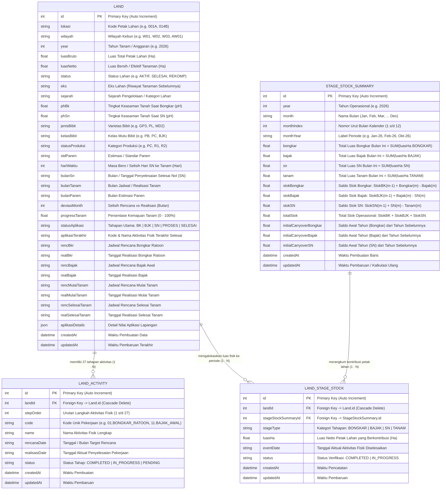

# ERD Arsitektur Data: Halaman Overview & Data Lahan

Dokumen ini merupakan acuan resmi **Entity Relationship Diagram (ERD)** yang dirancang khusus untuk memenuhi seluruh kebutuhan fungsional dan visual pada **Halaman Overview Dashboard** dan **Halaman Data Lahan & Rencana vs Realisasi**.

---

## 1. Visualisasi ERD Lengkap (Mermaid Diagram)



---

## 2. Pemetaan Relasi Database ke Komponen Halaman

Rancangan ERD di atas secara spesifik membagi beban data ke setiap komponen UI:

### A. Halaman Overview Dashboard

| No | Komponen UI Overview | Sumber Entitas / Tabel | Kolom / Formula yang Digunakan |
|---|---|---|---|
| **1** | **Executive Summary (3 Kartu Stok Fisik)** | `StageStockSummary` (dihasilkan via `LandStageStock`) | - **Stok Bongkar:** `stokBongkar` Ha<br>- **Stok Bajak:** `stokBajak` Ha<br>- **Stok SN:** `stokSN` Ha<br>- **Filter:** berdasarkan `year` & `month` |
| **2** | **Realisasi Tanam (Card)** | `Land` | - `SUM(luasNetto)` di mana `statusAplikasi = 'SELESAI'`<br>- Ditambah `50% * luasNetto` jika `statusAplikasi = 'PROSES'` |
| **3** | **Progress Tanam (Card)** | `Land` | - `(Total Realisasi Tanam / Total Luas Netto) * 100%` |
| **4** | **Posisi Lahan per Wilayah (BK, BJK, SN)** | `Land` | - Group by `wilayah`<br>- Count & Luas petak berdasarkan `statusAplikasi` (`BK`, `BJK`, `SN`) |
| **5** | **Rencana vs Realisasi Tanam per Wilayah** | `Land` & `LandActivity` | - Luas rencana tanam vs realisasi tanam per petak lahan yang dikelompokkan per wilayah |
| **6** | **Rerata Bero Lokasi SN (Tabel & Summary)** | `Land` | - `hariWaktu` (selisih hari dari `bulanSn` / tanggal SN ke tanam)<br>- Menghitung rata-rata masa bero per wilayah |
| **7** | **Monitoring Proses & Selesai Tanam** | `Land` | - Menghitung jumlah petak & luas lahan dengan kategori `SELESAI`, `PROSES`, dan `BELUM TANAM` |
| **8** | **Preview Tabel Data Lahan (10 baris teratas)** | `Land` | - Menampilkan daftar petak aktif dengan navigasi langsung ke halaman data lahan penuh |

---

### B. Halaman Data Lahan & Rencana vs Realisasi

| No | Fitur / Komponen Data Lahan | Sumber Entitas / Tabel | Fungsi & Cara Kerja |
|---|---|---|---|
| **1** | **Filter Multi-Select Header** | `Land` (dengan Database Indexes) | - **Tahun:** `Land.year`<br>- **Wilayah:** `Land.wilayah`<br>- **Status Lahan:** `Land.status`<br>- **Jenis Bibit:** `Land.jenisBibit`<br>- **Kelas Bibit:** `Land.kelasBibit`<br>- **Bulan Tanam:** `Land.bulanTanam` |
| **2** | **Pencarian Cepat (Search Bar)** | `Land` | - Pencarian teks pada kolom `lokasi` dan `wilayah` |
| **3** | **Tabel Utama (1.921 Petak Lahan)** | `Land` | - Menampilkan seluruh data lahan lengkap (lokasi, wilayah, luas bruto, luas netto, status aplikasi, tanggal realisasi, masa bero) |
| **4** | **Modal Profil & Timeline 27 Aktivitas (`LandDetailModal`)** | `Land` $\rightarrow$ `LandActivity` | - Menampilkan profil lahan dan daftar 27 urutan aktivitas fisik (dari `01.BONGKAR_RATOON` s/d `27.SELESAI_TANAM`) beserta status `COMPLETED`, `IN_PROGRESS`, atau `PENDING` |
| **5** | **Modal Edit Data Lahan (`LandEditModal`)** | `Land` & `LandActivity` $\rightarrow$ `LandStageStock` $\rightarrow$ `StageStockSummary` | - Operator mengubah luas lahan atau tanggal realisasi (Bongkar, Bajak, SN, Tanam).<br>- **Efek otomatis:** Perubahan langsung mengalir ke `LandStageStock` dan mengkalkulasi ulang `StageStockSummary` secara *real-time*! |

---

## 3. Alur Kalkulasi Otomatis (Dari `Land` ke `StageStockSummary`)

Ketika ada input/edit data petak di **Halaman Data Lahan**, sistem menjalankan alur perhitungan berikut:

```
[ MODAL EDIT DATA LAHAN ]
Operator mengupdate tanggal/luas petak lahan (Contoh: Petak 001A, Luas 10.5 Ha)
      │
      ▼
[ TABEL LAND & LAND_ACTIVITY DIPERBARUI ]
- realBkr          : 15-01-2026
- realBajak        : 10-03-2026
- bulanSn          : 20-04-2026
- realSelesaiTanam : 05-05-2026
      │
      ▼
[ TABEL PENGHUBUNG LAND_STAGE_STOCK DISINKRONISASI ]
- Baris 1: Petak 001A -> stageType: BONGKAR | luasHa: 10.5 | Periode: Jan-26
- Baris 2: Petak 001A -> stageType: BAJAK   | luasHa: 10.5 | Periode: Mar-26
- Baris 3: Petak 001A -> stageType: SN      | luasHa: 10.5 | Periode: Apr-26
- Baris 4: Petak 001A -> stageType: TANAM   | luasHa: 10.5 | Periode: Mei-26
      │
      ▼
[ TABEL STAGE_STOCK_SUMMARY DIKALKULASI ULANG SECARA BERANTAI ]
Jan-26:
  bongkar = SUM(luasHa BONGKAR Jan-26)
  stokBongkar = Saldo_Awal_BK + bongkar - bajak
Mar-26:
  bajak = SUM(luasHa BAJAK Mar-26)
  stokBongkar = StokBK(Feb) + bongkar - bajak
  stokBajak   = StokBJK(Feb) + bajak - sn
Apr-26:
  sn = SUM(luasHa SN Apr-26)
  stokBajak = StokBJK(Mar) + bajak - sn
  stokSN    = StokSN(Mar) + sn - tanam
Mei-26:
  tanam = SUM(luasHa TANAM Mei-26)
  stokSN = StokSN(Apr) + sn - tanam
      │
      ▼
[ EXECUTIVE SUMMARY PADA OVERVIEW LANGSUNG TERUPDATE SECARA LIVE ]
Angka Stok Bongkar, Stok Bajak, Stok SN di kartu langsung mencerminkan data terbaru lahan!
```

---

## 4. Keuntungan Arsitektur ERD Ini

1. **Sinkronisasi 100% Antar Halaman:**
   Tidak ada lagi perbedaan data antara tabel di menu Data Lahan dengan angka stok di menu Overview.
2. **Kemampuan Drill-Down:**
   Jika pengguna mengklik angka Stok Bongkar pada Executive Summary, sistem dapat menampilkan daftar petak lahan persis mana saja yang menyusun angka tersebut melalui `LandStageStock`.
3. **Performa Cepat (High Performance):**
   Dengan indeks pada `landId`, `stageStockSummaryId`, `wilayah`, dan `statusAplikasi`, query agregasi pada 1.921 petak lahan dieksekusi dalam hitungan milidetik (*sub-millisecond*).
4. **Relational Integrity:**
   Menggunakan aturan *Cascade Delete* dan *Foreign Key Constraints* sehingga data tetap konsisten dan tidak ada data yatim (*orphan records*).
